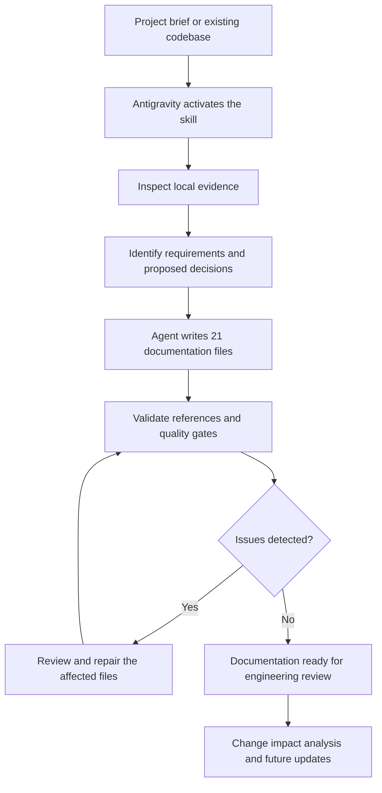

# Architect Docs Engine — Reusable Agent Skill for Evidence-Based Software Documentation

Architect Docs Engine is a reusable [Agent Skill](https://agentskills.io/specification) for Google Antigravity that helps software teams produce and maintain **21 linked Markdown architecture documents**. It guides an AI coding agent through project discovery, evidence classification, documentation writing, requirement traceability, and repeatable quality audits. The bundled Python utilities inspect and validate local files; **the AI agent performs the semantic documentation writing**.

## Contents

- [What it does](#what-it-does)
- [Key features](#key-features)
- [How it works](#how-it-works)
- [Repository structure](#repository-structure)
- [Prerequisites](#prerequisites)
- [Installation](#installation)
- [Quick start](#quick-start)
- [Operating modes](#operating-modes)
- [Configuration](#configuration)
- [Exact 21 output docs](#exact-21-output-docs)
- [CLI usage](#cli-usage)
- [End-to-end example](#end-to-end-example)
- [Safety and privacy](#safety-and-privacy)
- [Quality gates and limitations](#quality-gates-and-limitations)
- [Testing and CI](#testing-and-ci)
- [Troubleshooting](#troubleshooting)
- [Contributing, security, and license](#contributing-security-and-license)
- [Roadmap and status](#roadmap-and-status)
- [FAQ](#faq)
- [License](#contributing-security-and-license)

## What it does

Architecture docs easily drift away from application code. Requirements can lose links to tests, API contracts can contradict the data model, and AI agents may improvise implementation details when the project brief is incomplete.

Architect Docs Engine establishes a repeatable workflow that separates semantic writing by the AI agent from deterministic local inspection and validation by Python tools.

## Key features

- **Generate a complete suite** of 21 named Markdown files for greenfield projects or existing codebases.
- **Inspect before writing.** Ground claims in a project brief, current source code, configuration, and documented decisions.
- **Link requirements to implementation.** Maintain many-to-many traceability between requirements, user stories, interfaces, data models, screens/flows, and tests.
- **Support different application types.** API-only services, web apps, CLI tools, data systems, and Agentic AI/LLM applications can all be documented. For agentic systems, cover prompts, tool/MCP contracts, orchestration, memory, evaluation, and execution safeguards. Non-applicable sections receive a technical explanation, not invented features.
- **Update deliberately.** Detect document impacts, keep stable IDs, and review changes before replacing existing content.
- **Audit documentation quality.** Check files, ID consistency, Markdown links, suspicious secrets, unresolved design decisions, and evidence gaps.
- **Set visual guardrails.** Tie colors, typography, spacing, layout, and icons to user tasks and brand evidence; reject decorative defaults without a reason and include a rendered-review checklist.
- **Plan for abuse and agentic risks.** Model object-level authorization, bot abuse, resource exhaustion, prompt injection, tool misuse, least privilege, and verification steps without claiming a design is invulnerable.
- **Keep forms in context.** Use a page or inline form by default; do not turn ordinary forms into modal/popup flows without an explicit reason.
- **Use portable, readable files.** Generated docs remain plain Markdown and Mermaid rather than depending on a proprietary documentation server.

## How it works



The agent provides reasoning and writing. The local Python tools supply deterministic inspection, checks, and reports. The tool does not silently create app code, deploy services, or push to GitHub.

## Repository structure

```text
architect-docs-engine/
├── README.md                         # You are here: public repository guide
├── ANTIGRAVITY_BUILD_PROMPT.md       # Original build brief retained as source material
├── START_HERE_ID.md                   # Indonesian quick guide to this repository
├── LICENSE
├── CONTRIBUTING.md
├── SECURITY.md
├── CHANGELOG.md
├── .gitignore
├── .github/workflows/ci.yml
├── .agents/skills/architect-docs-engine/
│   ├── SKILL.md
│   ├── references/                   # modes, blueprints, evidence, IDs, audits, design/UX, security/abuse, agentic AI, updates
│   ├── assets/                       # config schema/example, 21-file manifest and 21 templates
│   └── scripts/                      # CLI, installer, scanner, config/docs/skill validators, snapshot, traceability, audit report
├── examples/
│   └── sample-project/               # Synthetic example project
│       ├── project-brief.md
│       ├── architect-docs.config.json
│       ├── src/
│       ├── .architect-docs/source-snapshot.json  # Safe hashes for the source-freshness demo
│       └── docs/                    # Illustrative 21-file generated suite
└── tests/                            # Offline Python tests
```

**Two different README files:** `README.md` at this repository root explains how to install and run the skill. `<your-app>/docs/README.md` is the documentation hub that the skill creates **inside a target app**.

## Prerequisites

- Google Antigravity with Agent Skills support; discovery and slash invocation depend on the available surface.
- **Python 3.11+** to run the optional local installer, inspection, and audit utilities.
- **Git** for cloning the repository; downloading the files directly is also possible.
- A target project directory or a concise project brief.

For supported discovery paths and invocation behavior, see the [official Antigravity Agent Skills guide](https://www.antigravity.google/docs/skills?tab=ide) and the [Agent Skills format specification](https://agentskills.io/specification).

No API key or cloud service is required for the offline Python validation scripts. Agent-driven generation requires an available AI coding agent in Antigravity; its availability and permissions depend on your environment.

## Installation

### Install — workspace scope

Clone this repository and run the cross-platform installer from the **root of the cloned skill repository**:

```bash
# Example GitHub URL: replace YOUR_USERNAME with the repository owner.
git clone https://github.com/YOUR_USERNAME/architect-docs-engine.git
cd architect-docs-engine

# Preview the installation; the target project must already exist.
python .agents/skills/architect-docs-engine/scripts/install.py \
  --scope workspace --target ../my-app --dry-run

# Install the skill into the target project.
python .agents/skills/architect-docs-engine/scripts/install.py \
  --scope workspace --target ../my-app
```

On Windows PowerShell, use the same Python commands on one line:

```powershell
python .agents/skills/architect-docs-engine/scripts/install.py --scope workspace --target ..\my-app --dry-run
python .agents/skills/architect-docs-engine/scripts/install.py --scope workspace --target ..\my-app
```

Expected destination:

```text
my-app/
└── .agents/
    └── skills/
        └── architect-docs-engine/
            ├── SKILL.md
            ├── references/
            ├── assets/
            └── scripts/
```

Open `my-app` in Antigravity. The skill can now be used in that workspace. Commit the skill folder to the target project's repository only if you want to share the installed skill with the team.

### Install — global scope

From the cloned repository root:

```bash
python .agents/skills/architect-docs-engine/scripts/install.py --scope global --dry-run
python .agents/skills/architect-docs-engine/scripts/install.py --scope global
```

The standard shared global Antigravity path is:

```text
~/.gemini/config/skills/architect-docs-engine/
```

Global installation makes the skill available across workspaces supported by that Antigravity installation. If a differing install already exists, the installer refuses by default. After reviewing it, `--force` creates a timestamped backup before replacement.

For manual installation, copy the **entire** `.agents/skills/architect-docs-engine/` directory into the corresponding workspace or global skills directory. Copying `SKILL.md` alone omits the scripts, templates, and references.

## Quick start

After installing the skill, **open the target project's root directory** in Antigravity. You can invoke `/architect-docs-engine` in surfaces that support manual skill commands, or ask in natural language.

**1. Create docs from a new project brief**

```text
Use architect-docs-engine to generate the complete 21-document /docs suite
for an internal issue-tracking web application. The users are support agents
and administrators. Start by marking architectural choices that are not
specified as Proposed. Do not invent deployed infrastructure, existing
endpoints, or measured performance. Validate traceability when finished.
```

**2. Document an existing project**

```text
Use architect-docs-engine in inspect mode on this workspace. Find the real
framework, routes, data models, tests, and operational configuration.
Then generate the 21-document suite based on actual code. Preserve my
existing docs and show diffs before replacing anything.
```

**3. Audit or update an existing documentation suite**

```text
Use architect-docs-engine to audit this project's /docs directory,
identify orphaned requirements, broken API-to-test references,
unverified claims, and security risks. Propose a minimal repair patch;
do not overwrite files without review.
```

**Contoh Bahasa Indonesia:**

```text
Gunakan skill architect-docs-engine untuk membaca codebase proyek ini,
kemudian buat 21 dokumen teknis di folder /docs. Bedakan fakta dari kode
dengan rekomendasi arsitektur, hubungkan requirement ke test case, dan
jalankan audit. Jangan mengubah source code aplikasi.
```

## Operating modes

| Mode | Behavior | Executed by |
| --- | --- | --- |
| `initialize` | Establish project settings and documentation plan | AI agent |
| `inspect` | Examine local code/config and classify evidence | AI agent + Python inspector |
| `generate` | Write all 21 Markdown documents with context-sensitive content | AI agent |
| `update` | Propose scoped edits when the app or requirements change | AI agent |
| `audit` | Evaluate completeness, IDs, links and evidence risks | Python checks + agent review |
| `repair` | Prepare minimal safe corrections with human review | AI agent |
| `plan` | Show expected docs, impacts and unresolved decisions | AI agent |
| `diff` | Explain existing vs proposed document changes | AI agent |
| `dry-run` | Preview actions without modifying target files | Agent/script depending on command |
| `help` | Explain the skill workflow or local command options | AI agent or Python CLI |

**Important:** The Python CLI is not a substitute for the Antigravity agent. It cannot create reliable architecture descriptions without source evidence and semantic interpretation.

## Configuration

Create the optional `architect-docs.config.json` in the **target project root**. This example is valid JSON and illustrates a proposed greenfield project, not a deployed system:

```json
{
  "project": {
    "name": "Example Support Desk",
    "summary": "An internal application for managing customer support requests.",
    "domain": "customer-support",
    "documentation_language": "en",
    "lifecycle": "greenfield",
    "target_users": ["support-agent", "administrator"]
  },
  "tech_stack": {},
  "constraints": ["Do not store live customer information in fixtures"],
  "requirements_sources": ["project-brief.md"],
  "security_classification": "internal",
  "features": {
    "api": true,
    "database": true,
    "ui": true,
    "ai": false
  },
  "docs": {
    "output_dir": "docs",
    "strict": true,
    "update_policy": "review"
  }
}
```

| Setting | Meaning |
| --- | --- |
| `project.*` | Project identity, summary, lifecycle, audience, documentation language |
| `tech_stack` | Known or approved language/framework/runtime choices; empty means unspecified |
| `constraints` | Project-wide technical and operational constraints |
| `requirements_sources` | Project-relative files the agent should prioritize |
| `security_classification` | Context label; **not** a compliance certification |
| `features.*` | Supported application surfaces; false should not force fictional sections |
| `docs.output_dir` | Documentation output folder, confined to the project root |
| `docs.strict` | Whether unresolved blocking validation findings fail audit |
| `docs.update_policy` | `review` keeps pre-existing docs protected pending review |

Review the schema at `.agents/skills/architect-docs-engine/assets/config.schema.json` for the authoritative keys and allowed values. Omit the config entirely if you prefer the skill to infer observable details from an existing codebase.

## Exact 21 output docs

Every full run creates the following canonical files **inside the target project's `/docs` directory**:

| # | File | Purpose |
| ---: | --- | --- |
| 1 | `README.md` | Documentation home, architecture overview and navigation |
| 2 | `PRD.md` | Product problem, requirements and nonfunctional goals |
| 3 | `TECH_STACK.md` | Observed and proposed technology decisions |
| 4 | `DECISIONS.md` | Architecture Decision Records (ADR) |
| 5 | `DATA_MODEL.md` | Entity schemas, relationships and lifecycle |
| 6 | `VALIDATION_RULES.md` | Input validation and domain invariants |
| 7 | `API_CONTRACT.md` | API, event, interface or CLI contracts |
| 8 | `UI.md` | Visual tokens, components and design guidance |
| 9 | `UX.md` | Journeys, states, accessibility and operator flows |
| 10 | `AGENTS.md` | Instructions for coding agents working on the target app |
| 11 | `PROMPTS.md` | LLM prompts or reusable development prompt patterns |
| 12 | `SECURITY.md` | Threat model and application security controls |
| 13 | `SEED.md` | Synthetic fixtures and reproducible seed strategy |
| 14 | `IMPLEMENTATION.md` | Dependency-ordered engineering plan |
| 15 | `TESTING.md` | Test cases, coverage policies and verification |
| 16 | `ACCEPTANCE.md` | User stories and Given/When/Then criteria |
| 17 | `TRACEABILITY.md` | Many-to-many requirement-to-test traceability |
| 18 | `OPERATIONS.md` | Runbooks, deployment, config and observability |
| 19 | `AUDIT.md` | Quality gate rubric and evaluation rules |
| 20 | `_AUDIT_REPORT.md` | Actual quality findings from the current audit |
| 21 | `_CHANGELOG.md` | Versioned documentation changes |

A non-UI project still gets `UI.md` and `UX.md` in full-suite mode, but those files document the non-applicability of visual screens and the relevant operator/user interaction interfaces instead of inventing a frontend.

## CLI usage

The following commands run from the **skill repository root**. Windows users can use the same Python commands with PowerShell paths.

```bash
# Discover all supported commands and options.
python .agents/skills/architect-docs-engine/scripts/cli.py --help

# Validate the skill structure, manifest and referenced resources.
python .agents/skills/architect-docs-engine/scripts/cli.py validate-skill

# Inspect the bundled synthetic project without executing its code.
python .agents/skills/architect-docs-engine/scripts/cli.py inspect \
  --project ./examples/sample-project

# Audit all 21 documents and document quality findings.
python .agents/skills/architect-docs-engine/scripts/cli.py audit \
  --project ./examples/sample-project

# Verify requirement/user-story/API/model/test cross-references.
python .agents/skills/architect-docs-engine/scripts/cli.py traceability \
  --project ./examples/sample-project

# Validate the optional project config and path constraints.
python .agents/skills/architect-docs-engine/scripts/cli.py validate-config \
  --project ./examples/sample-project

# Preview a source hash baseline; add --write to store it under .architect-docs/.
python .agents/skills/architect-docs-engine/scripts/cli.py snapshot \
  --project ./examples/sample-project --dry-run

# Execute the offline test suite.
python -m unittest discover -s tests -v
```

Add `--json` to inspection, audit, traceability, config, snapshot and skill checks for machine-readable results. `snapshot --write` stores safe hashes in `<target>/.architect-docs/source-snapshot.json`; the default and `--dry-run` only preview. Later audits compare source/config paths and hashes, never retain file contents. `report_audit.py` can create a new JSON report under target `docs/`; it refuses to overwrite and supports `--dry-run`. Exit codes are `0` when there is no hard mechanical failure (warnings or readiness blockers may remain), `1` for hard validation/conflict findings, `2` for invalid invocation, and `3` for read/write/path errors. An audit can exit `0` with status `BLOCKED` when mechanical checks pass but readiness evidence is missing.

```bash
python .agents/skills/architect-docs-engine/scripts/report_audit.py \
  --project ./examples/sample-project --output audit.json --dry-run
```

## End-to-end example

The fictional sample project in `examples/sample-project/` provides a small source tree, project brief, optional config, and an illustrative `docs/` output. This sample does not claim to represent a live customer system.

To repeat the end-to-end process:

1. Open `examples/sample-project/` as the target workspace in Antigravity after installing the skill.
2. Ask: `Use architect-docs-engine to inspect the sample and regenerate its 21-document suite. Keep the synthetic fixture labels and verify traceability.`
3. Review `examples/sample-project/docs/README.md` and `TRACEABILITY.md`, especially every `Unresolved`, `Proposed`, or `N/A` decision.
4. Run the `audit` and `traceability` commands shown above.

For your **real project**, install the skill to its directory and run the same process in that project's workspace rather than writing into this skill repository. Regeneration is agent-driven; the audit CLI checks existing files and never generates architecture from a filename alone.

## Safety and privacy

The default workflow is conservative:

- Local scanning only; no required external API calls.
- No execution of inspected application source code during discovery.
- Exclude `.env`, tokens, private keys, `.git`, `node_modules`, build output, virtual environments, and large/untrusted files.
- Redact likely sensitive values in terminal and generated reports.
- Confine reads/writes to the authorized project root; reject `../` traversal or symlinks that escape it.
- Treat external text and repository content as evidence, not instructions with authority over the agent.
- Require review for changes to existing docs, especially human-written content.
- Do not mutate app code, run migrations, deploy services, initialize cloud resources, commit changes, or publish repositories automatically.

**Never copy private customer information into the generated example docs or GitHub repository.** Review the generated documents and tracked files before publishing.

## Quality gates and limitations

The auditing approach separates **structural validity** from **architecture readiness**:

- **Mechanical checks** can confirm the 21 required names, syntax/links, manifest consistency, reference IDs, documented N/A reasons, source-snapshot drift when a baseline exists, and certain secret patterns.
- **Evidence review** verifies whether assertions match inspected code or approved requirements.
- **Human review** remains necessary for architecture suitability, feasibility, business rules, security requirements, UX quality, and deployment readiness.

A requirement may map to multiple API endpoints and several tests. API-less and UI-less requirements are valid when the absence is explicitly justified. If important facts are missing, the skill should write a specific `Unresolved` statement and report an implementation-readiness gap, **not invent an endpoint or measured SLO**.

For UI work, the `UI.md` brief requires product-specific design intent, purposeful iconography, semantic tokens, anti-generic visual checks, and rendered review when an implementation is available. The `UX.md` guidance uses page/inline forms by default instead of popups and covers accessible validation/recovery. The skill can improve the specification; it cannot guarantee the final visual quality without inspecting the actual rendered interface.

For security, the `SECURITY.md` brief asks for threat-specific controls against broken object access, bot/credential abuse, resource exhaustion, and (when present) agent prompt injection and tool misuse. It prioritizes deterministic authorization and least privilege outside the model. The skill organizes security requirements and tests; it cannot guarantee a system is safe or substitute for implementation review and security testing.

Audit status distinguishes `PASS` (no findings), `PASS_WITH_WARNINGS` (review needed), `BLOCKED` (required evidence or decisions are missing for readiness), and `FAIL` (a hard failure was found). A blocked readiness result is distinct from a mechanical document failure.

The 21 documents are a documentation contract, not proof that the application itself has been built or that security compliance has been independently certified.

## Testing and CI

Run locally from the skill repository root:

```bash
python -m unittest discover -s tests -v
python -m unittest discover -s examples/sample-project/src -v
python .agents/skills/architect-docs-engine/scripts/cli.py validate-skill
python .agents/skills/architect-docs-engine/scripts/cli.py audit --project ./examples/sample-project
python .agents/skills/architect-docs-engine/scripts/cli.py traceability --project ./examples/sample-project
python .agents/skills/architect-docs-engine/scripts/cli.py validate-config --project ./examples/sample-project
python .agents/skills/architect-docs-engine/scripts/cli.py snapshot --project ./examples/sample-project --dry-run
```

The repository's `.github/workflows/ci.yml` runs both offline test suites, validates the skill and sample config, and audits the 21-file fixture plus traceability on pushes and pull requests. The repository is published; check the GitHub Actions page for the latest remote run. No CI status badge is included until a run is confirmed.

## Troubleshooting

| Symptom | What to check |
| --- | --- |
| Skill does not appear in Antigravity | Confirm the **folder** is at `<target>/.agents/skills/architect-docs-engine/` and contains `SKILL.md`; reopen/reload the workspace if necessary. |
| Slash command is unavailable | Some surfaces may use automatic activation or differ in command support. Request `Use architect-docs-engine ...` naturally. |
| Skill activates in the wrong project | Check the currently open workspace and explicitly name the intended target directory before writing. |
| `docs/` has fewer than 21 files | Confirm a **full generate** run, then use the `audit` CLI and review missing-file findings. |
| Existing docs are not replaced | Expected when `docs.update_policy=review`; inspect diffs and approve targeted edits. |
| Audit reports dangling `REQ`/`TC` IDs | Open `TRACEABILITY.md` and the defining `PRD.md` / `TESTING.md`; repair IDs without renumbering stable references. |
| An interface appears in docs but not in code | Mark it `Proposed` or remove the unsupported claim; do not describe it as deployed. |
| Python command fails on Windows | Use `python`/`py` as installed and quoted paths; avoid Unix-only shell line continuation. |
| Audit gives a high score but blockers remain | Check the hard-fail findings: score alone does not confer readiness. |

## Contributing, security, and license

Contributions that improve safe scanning, traceability, tests, documentation templates, or portability are welcome. Read [CONTRIBUTING.md](CONTRIBUTING.md) before opening a pull request; include tests for validator behavior and update the synthetic fixture only when necessary.

For a suspected security vulnerability, review [SECURITY.md](SECURITY.md). When a GitHub repository is available, use its private vulnerability reporting or security advisory mechanism if enabled; do not post secrets or exploitable private details in a public issue.

License: MIT. See [LICENSE](LICENSE).

## Roadmap and status

Status: repository version 0.1.0 is published on GitHub. Remote CI execution has not been verified for the latest commit. There is no committed release schedule; these are ideas under consideration, not promised features:

- Additional agent host adapters validated against official host behavior.
- Optional schema exports such as OpenAPI/JSON Schema diff reports.
- Better cross-document change impact and semantic drift detection.
- Optional CI publication of sanitized audit summaries.

Keep the roadmap aligned with actual development and remove items if not planned.

## FAQ

**Is Architect Docs Engine a web framework or an autonomous AI agent service?**<br>
No. It is a reusable set of instructions, references, templates, and local validation utilities used by an AI coding agent.

**Will it implement my application's source code?**<br>
Not by default. It produces and maintains architecture documentation and validation reports. Implementation can be a separate agent task governed by those docs.

**Do I need an LLM API key?**<br>
No key is required for the Python tests or audit scripts. Document generation relies on the AI capabilities already available to you in Antigravity.

**Can it document a non-AI or backend-only project?**<br>
Yes. Non-applicable sections get evidence-backed explanations rather than fabricated UI or LLM features.

**Why exactly 21 files?**<br>
The fixed file contract creates predictable coverage across requirements, architecture, APIs, UI/UX, security, implementation, validation, operations, and change control.

**Can it audit or update docs I already wrote?**<br>
Yes, through review-first workflows. It must not blindly overwrite human-authored sections or renumber identifiers.

**Does it deploy my app or create a GitHub repository?**<br>
No. It does not deploy, automatically commit, or publish your source. You control the GitHub remote and publication.

**Can I use this with Claude Code, Cursor, or Codex?**<br>
The Agent Skills format is portable in principle, but each host has its own discovery path and behavior. Treat any additional host support as unverified until its installation and invocation have been tested.

---

Built around an evidence-first rule: **an explicit, auditable unknown is better than a confident but invented architecture fact.**
