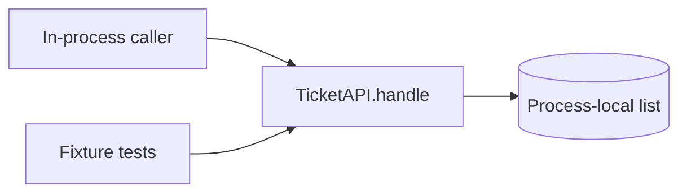

# Example Support Desk — project documentation

## Overview
This fictional fixture demonstrates a small in-process ticket dispatch interface implemented in Python. `TicketAPI` accepts and lists process-local ticket records through `handle(method, path, body)`; it does not start a network listener. Persistence, authentication, deployment, and an end-user visual interface are not implemented.

## Status
> **SYNTHETIC FIXTURE — NOT A DEPLOYED SERVICE.** Source and requirements are illustrative; production readiness is blocked on access, persistence, transport and operations decisions.

## Scope
This suite describes the tiny source fixture and requirements in [the fictional brief](../project-brief.md). Requirements and code snippets are illustrative fixture evidence, not claims about a customer system. Implementation readiness is limited by unresolved authentication, persistence, deployment, and data-retention choices.

## Quick start
There is no application startup command because `TicketAPI` is only an in-process class and the repository has no server adapter. From the sample-project root, run `python -m unittest discover -s src -v` to execute the fixture tests.

## Architecture

Observed from `src/app.py`; no network or database component is present.

## Project map
- `src/app.py` — in-process request dispatcher and transient ticket list.
- `src/test_app.py` — synthetic standard-library tests.
- `project-brief.md` — fictional product input.

## Glossary
- **Ticket:** one process-local support request record, `MODEL-001`.
- **Dispatch interface:** the in-process `TicketAPI.handle` method; its route strings do not imply a running HTTP service.

## Document index
- [Product requirements](PRD.md)
- [Technology choices](TECH_STACK.md)
- [Architecture decisions](DECISIONS.md)
- [Data model](DATA_MODEL.md)
- [Validation rules](VALIDATION_RULES.md)
- [Interface contracts](API_CONTRACT.md)
- [Visual system](UI.md)
- [User journeys](UX.md)
- [Target-project agent guidance](AGENTS.md)
- [AI and developer prompts](PROMPTS.md)
- [Security design](SECURITY.md)
- [Fixture strategy](SEED.md)
- [Implementation plan](IMPLEMENTATION.md)
- [Test strategy](TESTING.md)
- [Acceptance criteria](ACCEPTANCE.md)
- [Traceability graph](TRACEABILITY.md)
- [Operations](OPERATIONS.md)
- [Audit methodology](AUDIT.md)
- [Current audit record](_AUDIT_REPORT.md)
- [Documentation history](_CHANGELOG.md)
