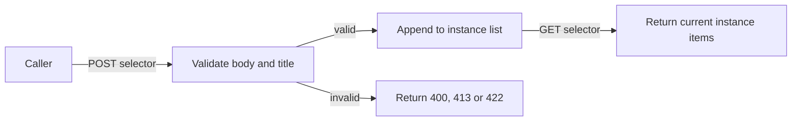

# User journeys and states

## Users and tasks
The fixture brief names fictional support staff as users. The present interaction is developer/operator-level because there is no network client or UI.

## Journey flows
**FLOW-001** — Create then list a ticket in one API instance (fixture):

## Interaction states
- Create: valid input returns a record; invalid JSON/field or oversize body returns an error object.
- List: returns an empty list before creation and records after creation; no pagination or persistence exists.
- Unknown selector: returns 404. Network loading, retry and offline UI states are absent because no client is implemented.

## Accessibility and recovery
**Not applicable —** keyboard and screen-reader screen behavior: there is no visual client. **Unresolved —** an eventual client must specify accessible form errors, focus movement, confirmation and retry behavior.
